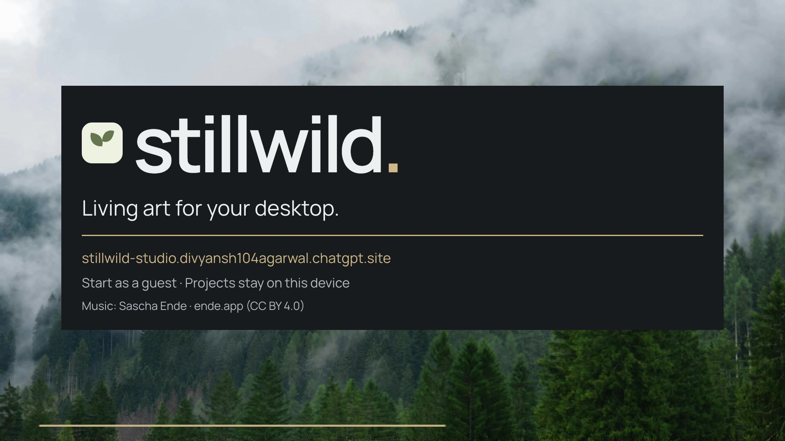
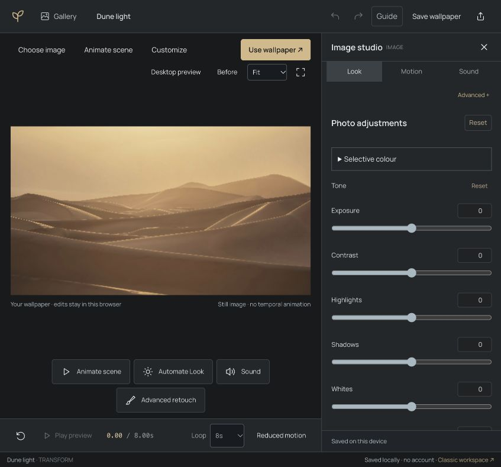
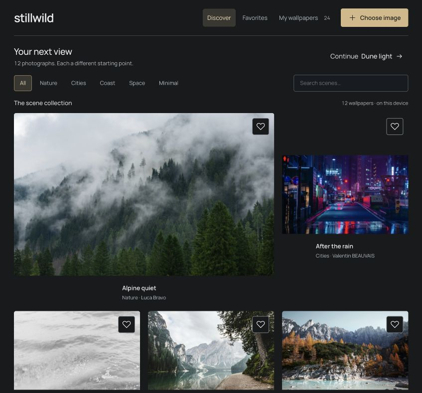

# Stillwild

**Living art for your desktop.**

A browser wallpaper studio built with Codex inside Asyncly for Asyncly Hackathon #1. Start with a photograph, shape its atmosphere, and keep the result as an editable project, a 4K wallpaper, or a video loop.

[Open the studio](https://stillwild-studio.divyansh104agarwal.chatgpt.site) · [Watch the 40-second demo](https://drive.google.com/file/d/1jgBOzWoCf7lKHia-4tNcH6h-ISeCJk5d/view?usp=drivesdk)

The demo is publicly viewable on Google Drive. Music, footage and production credits are in [Demo credits](docs/DEMO-CREDITS.md).

## Make a wallpaper

1. Enter as a guest. Pick one of 12 scenes, or import your own photograph.
2. Adjust light, colour, crop and selective colour. Use layers, masks and regions for local edits.
3. Add changing Look keyframes, local motion, optional generated video, and layered sound.
4. Preview the wallpaper fullscreen, then download a still or video loop. Keep an editable backup to return to it later.

Projects and imported media stay in this browser on this device. Generation sends the selected crop and prompt only when requested. No account or paid service is needed for local editing and export.

## Motion, three ways

| Route | What it does |
| --- | --- |
| Local studio motion | Flow/freeze guides, camera movement, local retouch and Look keyframes run in the browser. These move or grade existing pixels. |
| Wan | Optional generation through a shared public demo. No key or card; queues, quota and availability vary. |
| Your API | Connect a compatible JSON REST video service with an endpoint, session-only key, optional model and configurable request/response fields. Generated video is inserted directly into the same editable wallpaper. |

A key alone does not identify a service. The endpoint must support the configured format and browser CORS. Services using multipart, custom signing or other protocols need an adapter. Keys and connection settings are not saved in projects, backups or browser storage. See the [API contract and QA](docs/CUSTOM-API-QA.md).

Generated clips retain their original resolution and detail. Grading, crop, masks, Look animation and loop settings remain editable; the studio does not reconstruct arbitrary objects inside a rendered video.

## Tools and output

- Twelve photographic scenes, private image/video imports, text/shape/gradient layers, masks, region tools and selective colour.
- Undo/redo, pause/play, reduced motion, fullscreen preview, local saves, portable project backups and composition links for bundled media.
- Nine procedural sound choices plus private audio imports; sound starts only by user action. Video export is silent by default, with project sound optional.
- Artwork-only PNG at **3840 × 2160**, 2560 × 1440 or 1920 × 1080.
- Local **1920 × 1080 WebM** loop export with timestamped frames. A separate desktop wallpaper host is needed for video wallpapers.
- Classic access to the earlier botanical Shadow Garden, watercolor Rainprint and procedural theme families.

Native Plash, Lively and Wallpaper Engine integration is not implemented or verified. Local pixel retouch is not semantic scene reconstruction or physical relighting.

## Run locally

Use Node.js **22.18+** and npm. The unit tests use Node's [built-in TypeScript support](https://nodejs.org/api/typescript.html). The published snapshot was checked locally with Node 25.9.0.

~~~sh
npm ci
npm run dev
~~~

Open the Local URL printed by Vite. No environment file, backend or API key is needed for the core studio.

~~~sh
npm test
npm run build
npm run preview
~~~

The unit suite contains **109 tests**. The accepted release also passed focused browser checks for generation handoff, editable insertion, cancellation, legacy media, persistence, mobile access and Undo/reapply, plus a real 3840 × 2160 download from the public deployment. Provider traffic in the latest connection tests was mocked; it is not a live compatibility guarantee for every service.

The historical browser scripts retain their original local fixture requirements. Private runtime clips and test captures are intentionally absent from this repository; they are not required by `npm test` or `npm run build`.

## Build and assets

Application code was written during the event through Codex inside the existing Asyncly project. This repository is a publication snapshot of the accepted release; application source is unchanged. Hosting credentials, private projects, imported media and runtime captures are excluded.

The app uses React/React DOM, TypeScript, Vite, the official `@gradio/client` 2.7.2, and unmodified Mediabunny 1.65.2. Mediabunny is MPL-2.0; its full license and source notice are preserved. Manrope is SIL OFL 1.1. Playwright is used for browser verification.

The twelve photographs/telescope images are reused licensed assets, with credits to Luca Bravo, Valentin BEAUVAIS, Annie Spratt, Zetong Li, Matt Artz, Paul Hanaoka, NASA, and NASA/ESA/LEGUS/Hubble. The two older Classic backplates were generated during the event and are identified as generated artwork.

- [Photo credits](public/PHOTO-CREDITS.html) and [exact photo provenance](public/photos/provenance.json)
- [Photographic asset disclosure](docs/PHOTO_ASSETS.md) and [generated art disclosure](docs/ART_ASSETS.md)
- [Third-party notices](public/THIRD-PARTY-NOTICES.txt)
- [Detailed build, reuse and verification notes](BUILD-NOTES.md)
- [Demo music and footage credits](docs/DEMO-CREDITS.md)

Optional generation uses external services and their models; Stillwild does not train or own those models. Keep provider quotas, charges and compatibility in mind when choosing a connection.
