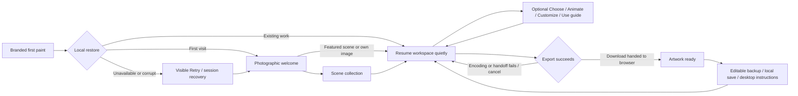

# Stillwild guest journey · 9 November 2026

The entry extends the existing studio: instant guest access, local projects, optional guidance and an artwork delivery finish. No account, backend, runtime dependency or new image asset was added. Existing photograph credits/licenses and Manrope OFL remain unchanged. Development direction: [contract](GUEST-JOURNEY-CONTRACT.md).

## Behavior and preservation

- First paint is real HTML while the JavaScript bundle loads. Delayed/failed loading exposes Reload; no fake percentages or imposed waiting period.
- Local restore has a 4.5-second bound. A failed restore keeps its saved record untouched. Bundled compositions remain usable in memory; recovery never silently enables autosave over unread work. An explicit import/save retains its existing behavior.
- New visitors can create from Alpine, Dune or Tokyo, choose their own image, explore the gallery or skip. Each featured choice loads its actual photograph and opens that composition. The photograph has a 5-second loading fallback and Retry; actions remain usable.
- Only `stillwild.welcome.v1=1` records completed/skipped welcome. A restored v14 project bypasses ceremony without that key. Shared photo/Classic hashes and explicit studio/Classic URLs bypass welcome.
- Replay retains the mounted workspace, private references, history and latest appearance. Resume and all navigation are disabled while an asynchronous scene-open operation is busy. Opening errors keep welcome visible. Focus returns after inert clears.
- The optional guide invokes existing scene choice, generation panel, light/colour, crop, Look tracks, sound and delivery. It closes when opening a task. Its statuses come from image/video/appearance/export state; clicking steps does not complete them. Generation is optional, with existing queue/API distinctions retained. Sound never starts from entry or guide.
- Completion is recorded only after nonempty encoded output reaches the browser download handoff. A PNG completion belongs to its exact current frame; video completion ignores the preview clock. New appearance/keyframe edits or a different project invalidate the finish state. Failed/cancelled exports do not complete it. Browser handoff is not proof of a file saved by the operating system.
- The finish offers local save, an editable backup, desktop instructions and Done. The guide and entry never enter the shared artwork renderer. Native live-wallpaper host compatibility remains unverified.

## Validation scope

Baseline **92/92** unit tests passed before implementation. The full unit run passed **99/99**; the seven focused journey cases also passed after the finish changes. They cover route decisions, storage-safe welcome state, real edit/Undo detection, asynchronous open failure, download failure/cancellation and PNG frame identity. Existing provider/media checks were not broadly repeated.

A real isolated UI flow chose Dune, edited Exposure with Undo/Redo, opened its real animation prompt without generating, imported a local licensed thumbnail through the native file chooser, edited it, downloaded a **3840×2160 PNG**, downloaded its portable project and saved it locally. The portable file retains the exact original image bytes and Exposure 0.45. The small source fixture verifies delivery without pretending to contain 4K source detail.

The returning fixture contains **20 saved wallpapers**, a private image and sound metadata. It opens quietly with the welcome key removed and no audio nodes. My wallpapers also retains navigation drafts; those are additional to named saves. Explicit studio, photo share and Classic links, actual reduced-motion/coarse-touch entry, slow/failed featured-image recovery and blocked storage are checked in disposable contexts. All external requests are blocked.

The original corrupt-restore assertion now passes on the final source: welcome and its recovery banner are both visible, the raw `{version:666,broken:true}` record remains unchanged after waiting, and Skip opens the gallery. `edge-report.json` contains this fresh result plus the five earlier passing route/return/recovery groups, each marked as retained with its source. The separate in-memory recovery check also opens Dune without overwriting that corrupt record and verifies the visible Session only status. The earlier red `edges.log` is retained as failure evidence; `corrupt-final.log` and `edge-report.json` close that gate.

Focused source-review regressions use explicit local module fixtures for a delayed/rejected scene-open and mocked export lifecycle. Those confirm locked Resume, visible open errors, focus after inert, PNG invalidation after a real scrub and video cancellation without claiming another real encoded video. The production video encoder is unchanged; prior v14 decoded-media evidence remains historical.

## Visual and motion evidence

Evidence is under `.asyncly/visual-captures/guest-journey/`. The initial desktop/mobile/user-width batch caught the inherited Classic title style. The final correction pins the title to Manrope and `#f6f7f5`, keeps the selected scene label readable, and includes short 1280×720 layout coverage. Valid final entrance captures must be used, with recorded actual viewport and device scale 1. Gallery, guide and delivery captures cover 1280×900, 390×844 and 847×789.

The only authored sequence is a 720ms transform-based exposure opening and photographic settle, gated on the current image’s decoded readiness. No entrance canvas, perpetual RAF, cursor replacement, autoplay sound or editor-control choreography was added. Reduced motion uses a static picture and a 120ms opacity change; hidden-page playback pauses. Entrance DOM/listeners are removed on entry. Gallery also suspends the preview clock.

The detector ran once on new UI files: one retained false positive identifies the punctuation dot in the Stillwild title as an accented word. It is punctuation, not an accented headline word. No additional detector run or unrelated restyle was performed.

## Limits and review

Device storage can be unavailable, full or cleared by the browser; keep portable backups. Imported media requires working private storage, while bundled scenes remain usable in session recovery. The 20-project check uses a disposable fixture, not the operator’s public browser. Public restoration, live provider generation and publication remain with the supervisor. The build retains the existing large-chunk advisory.

Final local reports, capture provenance, review disposition, source digest and changed files are indexed in the handoff manifest. No provider request, credential, account/terms action, commit, push or deployment was performed.

## Four requested finish corrections

The supervisor’s independent FIX disposition accepted the photographic world, hierarchy and delivery. The final local batch addresses exactly its four items:

1. The full 720ms focal reveal begins only after the current photograph decodes. A delayed image held longer than the animation duration still starts a fresh reveal; rapidly switching Dune → Tokyo cannot let a late Dune decode trigger Tokyo. Placeholder and actions stay usable. The reduced-motion fade is explicitly 120ms despite the inherited global override; keyboard scene changes are static.
2. Each guide step explicitly stacks label above status, aligns to the start and wraps within its column. Actual bounds checks and recaptured guide views pass at 390, 847 and 1280 pixels.
3. Guide/recovery chrome, including recovery toasts, is absent during both native fullscreen and the rejected-native CSS fallback, and returns on exit. The targeted check exposed a collapsed fullscreen pasteboard; its scoped full height now keeps the entire artwork inside the viewport. Exit remains visible. Recovery/footer save wording follows actual storage status.
4. Welcome, Boot and recovery hover foregrounds are scoped away from the inherited Classic green. Dark controls keep light text; the warm primary keeps dark text. Settled computed colours pass. Classic source/styles are unchanged.

The four-fix report and current entrance/guide/fullscreen captures are authoritative for this batch. The unchanged gallery/delivery captures retain their original time and scope. A short **real-time Playwright recording** now covers fresh boot/welcome and all three scene choices at production timing; the missing official ffmpeg QA binary was installed in Playwright’s cache with authorization. No app dependency changed. Earlier failed recorder attempts and interim test diagnostics are retained, superseded by the successful recording and targeted checks.

The supervisor reports a final **SHIP** disposition: all four scoped correction groups are resolved, and the updated current-source captures and real entrance recording have been reviewed. The original corrupt-restore gate is closed by `corrupt-final.log` and the six passing groups in `edge-report.json`, with five retained checks preserving their provenance. The independent documentation check is still in progress; packaging, public 20-project restoration, replay/download checks and publication remain with the supervisor. App and test source is frozen. No further style exploration or old provider/media audit was performed.

## Evidence map

Paths below are relative to `.asyncly/visual-captures/guest-journey/`. Reports describe their actual scope; earlier mixed runs are not presented as clean full-suite passes.

| Gate | Evidence | Result and scope |
| --- | --- | --- |
| Existing and new state logic | `baseline-units.log`, `final-units.log`, `final-focused-units.log` | 92 baseline, 99 full, then seven focused cases pass |
| Real first-use delivery | `browser.log`, `browser-diagnostics.json`, `first-wallpaper-4k.png`, `first-wallpaper.stillwild.json` | Real 4K PNG and exact private-image backup; initial run also recorded a subsequently fixed initialization error |
| Return, routes and recovery | `edge-report.json`, `retained-edge-checks.json`, `corrupt-final.log` | Six passing groups: five retained, corrupt restore freshly confirmed |
| Async open and callback failures | First three passes in `finish.log` | Busy/rejected opening, restored focus, mocked frame completion and video cancellation |
| Pre-React boot and in-memory recovery | `confirmation.log`, `finish-diagnostics.json` | Boot reload and corrupt/session recovery pass; this run later stopped at the then-missing recorder binary |
| Decode readiness, reduced/keyboard motion and guide columns | First four passes in `four-fixes.log` | Targeted regressions pass; later Boot fixture import failure was corrected |
| Hover, settled fresh entries and real recording | `four-fixes-final.log`, `four-fixes-report.json` | Pass; no page errors |
| Final native/fallback fullscreen, including toast suppression | `fullscreen-final.log`, `fullscreen-report.json` | Pass; final two captures inspected |
| Current visuals | `desktop-entry.jpg`, `mobile-entry.jpg`, `user-entry.jpg`, `short-entry.jpg`; three `*-guide.jpg`; two `*-wallpaper.jpg` | Final affected confirmation; actual sizes and credits checked |
| Accepted unchanged gallery/delivery | Three `*-gallery.jpg`, three `*-delivery.jpg` | Retain their original capture time and scope |
| Actual entrance recording | `entrance-realtime.webm`, `recording-media.json`, `entrance-replay.html` | UI recording: 1280×900, VP9, 102 frames, 4.080s, silent; distinct from wallpaper export evidence |
| Build, whitespace and frozen source | `final-build.log`, `whitespace.log`, `handoff.json` | Build and whitespace pass; full source hashes and capture provenance indexed |

Historical test stops remain visible: the initialization error, a navigation-draft fixture count, a delayed-module harness race, the Boot fixture’s CJS import, hover sampling during transition and the missing recorder binary. Their targeted confirmations are identified above. No additional capture cycle or broad provider/media rerun was used to close the final recovery gate.
